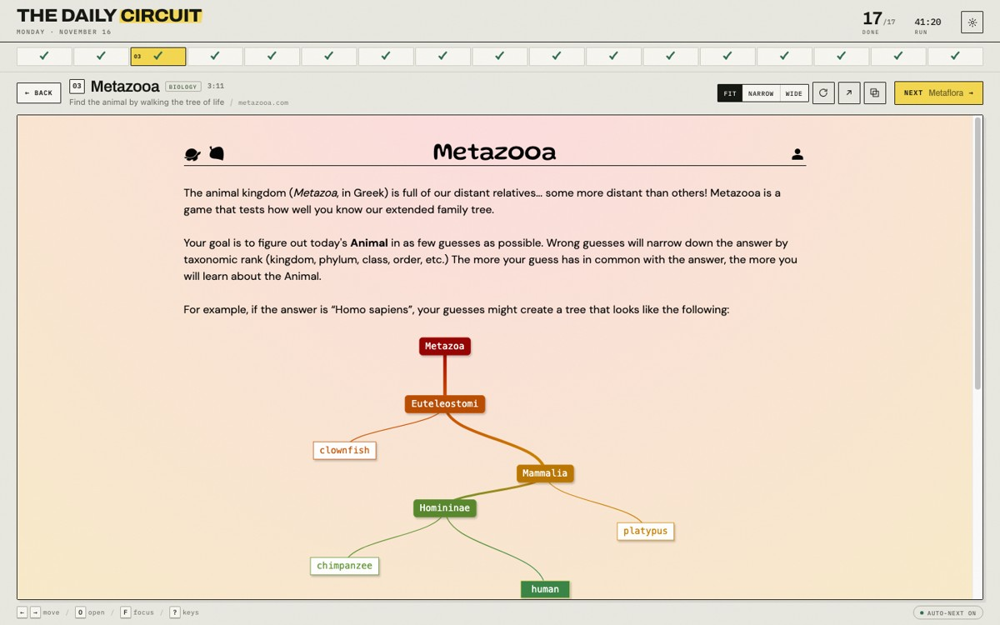

# The Daily Circuit

Seventeen daily games, in one tab, in a fixed order. Back and next arrows move you
through the run; each game gets ticked off on a scorecard rail; the day's total time
is on the clock. Progress is saved in your browser and clears itself at midnight.

No build step, no dependencies, no server. Plain HTML, CSS, and JavaScript served as
static files.



---

## Run it locally

```bash
python3 -m http.server 8099
# then open http://127.0.0.1:8099
```

Opening `index.html` directly works too, but a tiny server keeps `localStorage`
behaving the same way it will on the real host.

## Deploy to GitHub Pages

The repo ships with a Pages workflow (`.github/workflows/pages.yml`), so hosting is
one push:

1. Create an empty repository on GitHub — **do not** add a README or .gitignore.
2. This folder is already a git repo with one commit. Point it at the new repository
   and push:

   ```bash
   git remote add origin git@github.com:YOUR-USER/YOUR-REPO.git
   git push -u origin main
   ```

3. In the repository: **Settings → Pages → Build and deployment → Source =
   GitHub Actions**. The first workflow run publishes the site at
   `https://YOUR-USER.github.io/YOUR-REPO/`.

If you have the GitHub CLI, all three steps collapse into:

```bash
gh repo create YOUR-REPO --public --source=. --push
gh api -X POST repos/YOUR-USER/YOUR-REPO/pages -f build_type=workflow
```

The second command switches Pages to the Actions source; without it the first workflow
run has nowhere to deploy.

### Vercel, Netlify, anything else

The folder is a static site, so any static host works with zero configuration:
import the repo, leave the build command empty, set the output directory to `.`.
`index.html` is the entry point.

---

## How it works

| Piece | What it does |
| --- | --- |
| `index.html` | The shell: masthead, scorecard rail, stage, launch card, finish card |
| `assets/games.js` | The running order and per-game settings — the only file you edit to change the list |
| `assets/app.js` | Navigation, persistence, timers, keyboard, popup auto-advance |
| `assets/styles.css` | The look |

**Embedding.** Most of these games are served without `X-Frame-Options`, so they render
inside the page. Two do not: the New York Times sends `X-Frame-Options: DENY` on Wordle
and Connections, so those get a launch card and open in their own window.

**Continuing to the next game.** For the two windowed games, closing the game window
counts as finishing: the page notices, ticks the round off, and moves on. That is the
only completion signal a browser will give you across domains — an embedded game lives
on another origin, so this page cannot see its board, its `localStorage`, or whether you
have solved it. Embedded rounds advance on `→` (or the Next button), which is one
keystroke and no tab hunt.

Turn the window-close behaviour off in **Setup & shortcuts** (gear icon, or `?`).

**The clock and the card.** Each game's time accumulates while the page is visible;
the run total is the sum. The rail is the scorecard: the current game is highlighted,
finished ones get a check. The finish card only appears after the seventeenth game.

---

## Keyboard

| Key | Action |
| --- | --- |
| `→` / `N` | Next game (ticks this one off) |
| `←` / `P` | Previous game |
| `O` | Open this game in its own window |
| `E` | Switch between embedded and own window (remembered per game) |
| `R` | Reload the game |
| `W` | Cycle frame width: fit → narrow → wide |
| `F` | Focus mode — hides everything but the game |
| `1`–`9` | Jump to a game |
| `?` | Setup and shortcuts |
| `Esc` | Close the panel / leave focus mode |

Keys apply when the page itself has focus. Once you click into an embedded game, its
own keyboard handling takes over; click the grey margin (or press `F` twice) to get the
page's keys back.

## Editing the running order

`assets/games.js` is a plain array. Order in the file is order on the site:

```js
{
  id: 'metazooa',            // stable key for saved progress; don't reuse
  name: 'Metazooa',          // shown everywhere
  url: 'https://metazooa.com',
  note: 'Find the animal by walking the tree of life',
  tag: 'Biology',            // small label; unknown tags just get the default colour
  width: 'fit',              // optional: 'fit' | 'narrow' | 'wide'
  mode: 'embed'              // optional: 'embed' (default) or 'tab'
}
```

Changing `id` resets that game's saved progress. Changing the array length updates the
rail, the `/17` counters, and the finish card automatically.

**If a game stops embedding**, either add `mode: 'tab'` in `games.js` or press `E` while
on that game — the choice is remembered. If it shows a blank frame, the site has started
sending a framing header; `E` is the fix.

## Notes and limits

- **One page, one run.** Progress is per browser, per day, local only. Nothing is sent
  anywhere; there is no analytics, no cookies, no backend.
- **Daily reset** happens at your local midnight. Some games roll over at a different
  hour (or in UTC), so a puzzle can occasionally still be yesterday's. The refresh
  button reloads the frame; *Reset today's run* starts the card over.
- **Globe-style games need WebGL.** If a browser has it disabled, the game itself will
  complain — that is the game, not the shell.
- **Their page, their rules.** Embedded games keep their own ads, sign-in, and layout;
  this page only wraps them. Some are wide layouts and will look better in *Narrow*.
- The site works on phones, where the rail collapses to seventeen check boxes and the
  arrows stay at the top.
